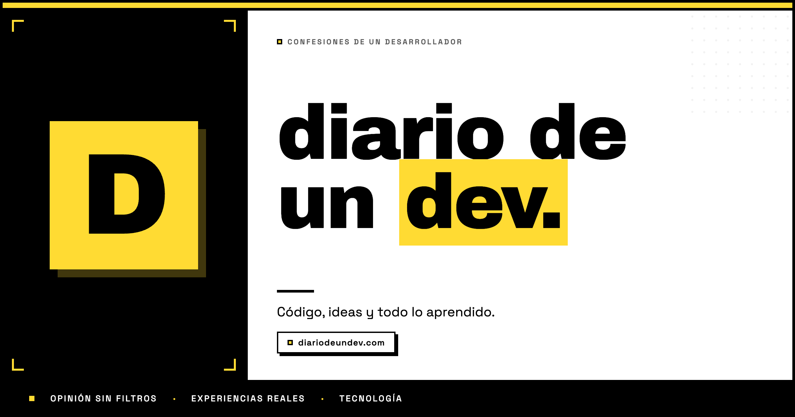

# Diario de un Dev

### Opinión, experiencias y tecnología escritas sin prisa.

[**Leer el blog →**](https://diariodeundev.com)

## Un diario sobre el oficio de crear software

**Diario de un Dev** es mi rincón personal para escribir sobre desarrollo web, inteligencia artificial y todo lo que voy aprendiendo por el camino.

Aquí tienen cabida las decisiones técnicas, los errores que terminan enseñando algo, las ideas todavía a medio formar y la parte menos visible de trabajar como desarrollador. Sin fórmulas mágicas, sin contenido de relleno y sin postureo.

> Este repositorio es solo la portada del blog. El código del sitio es privado; aquí encontrarás únicamente la información de los artículos publicados.

## Qué encontrarás

- Experiencias reales del día a día como desarrollador.
- Reflexiones sobre tecnología e inteligencia artificial.
- Aprendizajes, decisiones y errores construyendo productos.
- Opinión personal sobre cómo cambia nuestro oficio.
- Artículos escritos cuando hay algo que merece la pena contar.

## Artículos publicados

### [Un secreto a voces](https://diariodeundev.com/blog/un-secreto-a-voces)

¿Hasta cuándo mantendremos la compostura? Alguien acabará haciendo cuentas.

`15 de octubre de 2026` · `Opinión` · inteligencia-artificial, desarrollo, carrera, productividad

---

### [¿Esto sirve para algo?](https://diariodeundev.com/blog/esto-sirve-para-algo)

Se trata de no confundir la capacidad de construir algo con la capacidad de comprenderlo.

`5 de agosto de 2026` · `Opinión` · inteligencia-artificial, desarrollo, aprendizaje, automatización

---

### [¿Perderán capacidades nuestros hijos por usar la IA? Explorando posibles soluciones](https://diariodeundev.com/blog/sera-la-ia-mala-para-nuestros-hijos)

¿Cuánto afectará al desarrollo de sus capacidades para razonar, aprender y resolver problemas por sí mismos?

`16 de julio de 2026` · `Experiencias` · inteligencia-artificial, educacion, desarrollo, paternidad

## Enlace

🌐 **[https://diariodeundev.com](https://diariodeundev.com)**

---

Escrito y construido por **Luis**.

